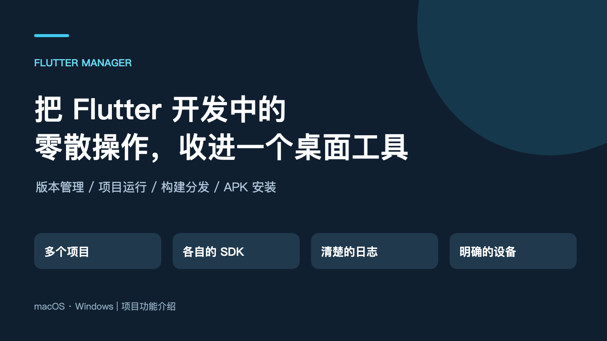
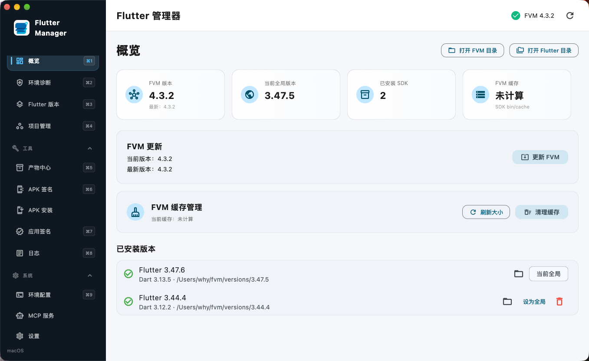
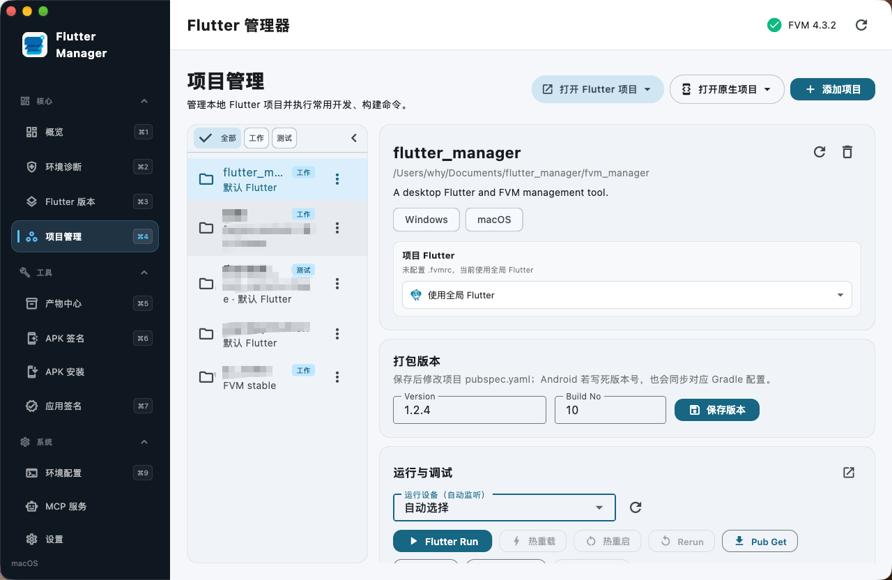
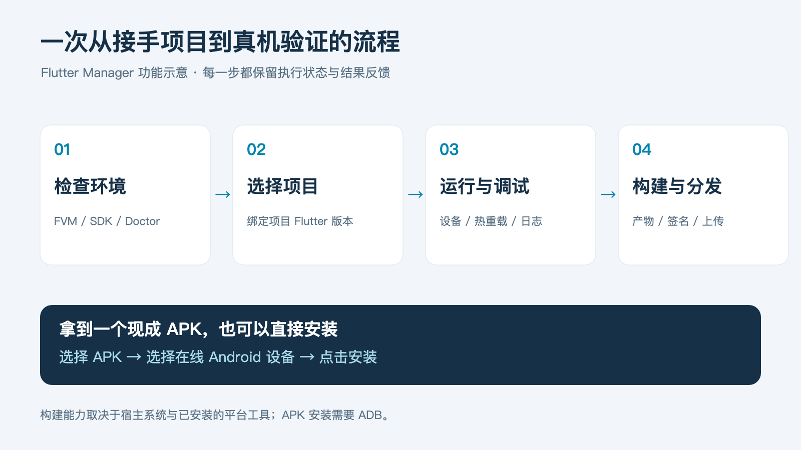
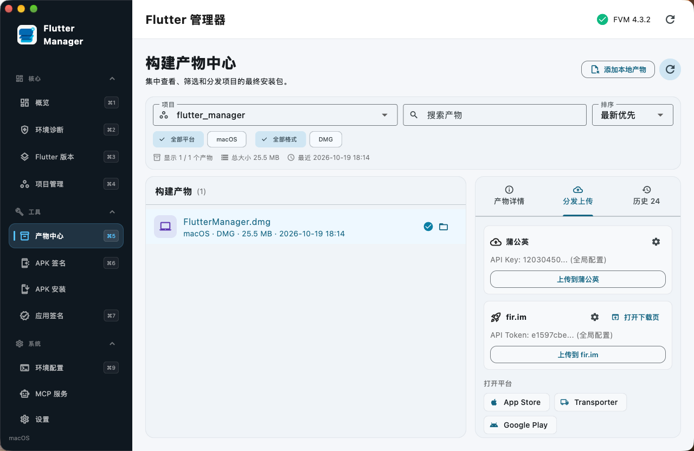
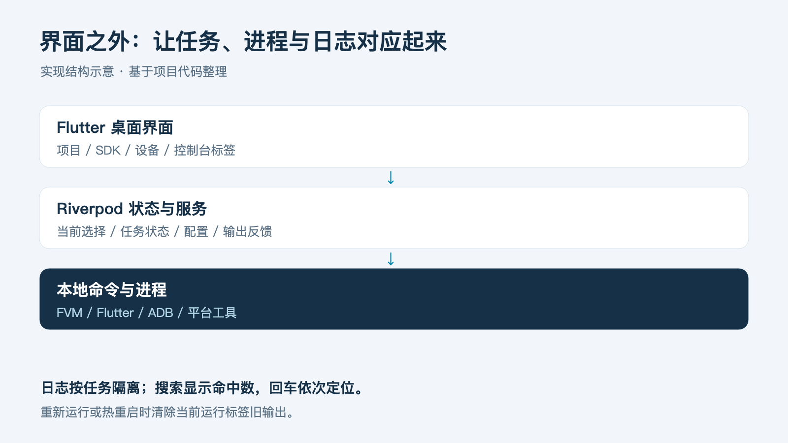

# Flutter Manager

> 把 Flutter 开发里那些「不难、但特别容易打断思路」的小事，收进一个桌面工具。

**Flutter Manager** 是一个面向 **macOS / Windows** 的 Flutter 开发桌面管理工具。它把 FVM 多版本 SDK、项目运行调试、构建产物、控制台日志、APK 安装与第三方分发，放进同一个界面。

维护多个 Flutter 项目时，真正消耗注意力的往往不是写业务代码，而是反复确认环境：

- 这个项目用哪个 Flutter 版本？本机装了没有？
- 设备到底连上没有？
- 刚才那段报错，属于运行任务还是构建任务？
- 拿到测试包之后，该装到哪台手机、往哪里传？

这些步骤单独看都很小，项目一多就变成了每天的固定开销。Flutter Manager 想先把这些重复确认省掉。

<p align="center">
  
</p>


---

## 下载

前往 [下载最新正式版](https://github.com/haoyuanwu/flutter_manager/releases/latest)，在附件中选择对应安装包。此入口会随新版本发布自动更新。

| 平台 | 芯片 / 架构 | 安装包文件标识 |
|------|-------------|----------------|
| **Windows** | x64 | `*-windows-x64-setup.exe` |
| **macOS** | Apple Silicon（苹果芯片） | `*-arm64.dmg` |
| **macOS** | Intel（英特尔芯片） | `*-x86_64.dmg` |

历史版本请前往 [全部 Releases](https://github.com/haoyuanwu/flutter_manager/releases)。

---

## 功能一览

| 模块 | 做什么 |
|------|--------|
| **环境概览** | 一眼看清 FVM、全局 Flutter 版本、已安装 SDK 与缓存 |
| **SDK / FVM** | 下载、解压、设置全局版本；项目独立版本；镜像切换 |
| **项目管理** | 本地项目列表、平台/flavor 识别、运行 / 依赖 / 清理 / 构建 |
| **控制台** | 多任务标签隔离、搜索定位、热重载 / 热重启 / 重新运行 |
| **产物中心** | 查找安装包，一键上传蒲公英 / fir.im |
| **APK 安装** | 不打开源码，三步把 APK 装到在线 Android 设备 |
| **签名与工具** | APK 签名、应用签名信息、Bugly 符号表上传 |
| **MCP（可选）** | 让支持 MCP 的 AI 工具操作本机项目与运行状态 |

---

## 界面速览

### 概览：先看清当前环境

<p align="center">
  
</p>

集中展示 FVM 版本、全局 Flutter 版本、已安装 SDK 与缓存，并提供打开目录、切换全局版本等入口。  
「全局版本」和「项目版本」分开表达——旧项目可能有依赖约束，新项目可能需要另一套 SDK。

> 概览截图中的版本号为演示数据；截图里仍可见旧版「日志」入口，当前代码已隐藏该侧边栏入口。

### 项目管理：把一次开发流程串起来

<p align="center">
  
</p>

典型流程：

1. 添加本地 Flutter 项目，确认项目使用的 SDK  
2. 选择目标设备，运行项目  
3. 修改代码后热重载，必要时热重启或重新运行  
4. 按目标平台和构建选项生成产物，再到产物中心查看与分发  

项目目录被移动后支持重新定位，也可删除失效记录。

<p align="center">
  
</p>

*功能流程示意，非产品界面截图。*

### 控制台：让每段输出都有归属

- 多任务 / 多项目 **标签隔离**，主窗口只显示当前选中标签  
- 搜索显示命中总数，回车逐条定位；滚动按真实文字布局计算  
- 关闭运行中的标签会先停止对应命令  
- 重新运行 / 热重启会清掉本轮旧输出，减少「这是刚才的报错还是现在的」困惑  

### 产物与分发：构建结束，接着交付

<p align="center">
  
</p>

配置好凭据后，在产物中心选中安装包，一键上传到 **蒲公英** 或 **fir.im**，查看进度与结果。  
APK 签名、应用签名信息、Bugly 符号表上传也有独立入口。

> 可上传的文件格式以目标平台规则为准。截图中选中的是本地 DMG，仅用于展示入口。

### APK 安装：拿到包之后不必先开源码

**选择 APK → 选择在线 Android 设备 → 点击安装。**

通过 ADB 获取设备，多设备时明确指定目标；离线 / 未授权设备会有提示。  
需要本机安装 Android SDK Platform-Tools，并为设备开启、授权 USB 调试。

---

## 可选：MCP 接入

让支持 MCP 的 AI 工具结合本机项目与真实运行状态进行操作，而不只是生成一串待复制的命令。

```text
支持 MCP 的 AI 工具
        ↓ stdio
Flutter Manager MCP Server
        ↓ 本机 HTTP (127.0.0.1)
Flutter Manager App
        ↓
项目 · 设备 · 运行任务 · 控制台
```

- App 控制接口 **只监听 `127.0.0.1`**，不会向局域网或外部网络开放  
- 当前能力包括：列出/选择项目、列出设备、运行、重新运行、热重载、热重启、读取控制台等  
- MCP Server、App 控制接口、AI 工具配置需分别完成；Skill 提供使用说明  

配置示例与 Skill 安装说明见 [`fvm_manager/mcp_server/README.md`](fvm_manager/mcp_server/README.md)。

---

## 设计上在意的三件事

<p align="center">
  
</p>

1. **操作要有明确上下文** —— 当前项目、设备、SDK、任务标签，都不能依赖含糊的默认值  
2. **界面状态要跟真实进程对应** —— 启动、运行、停止、启动中停止，都要能解释；关闭标签要知道命令是否还在跑  
3. **输出应该帮人做判断** —— 哪个任务的日志、命中第几处、这轮运行从哪开始  

---

## 技术栈

- **Flutter Desktop**（macOS / Windows）
- **Riverpod** 状态管理与依赖注入
- **Freezed** 不可变模型
- **Dio** 下载，**archive** 解压
- 多窗口控制台（desktop multi-window）
- 底层仍依赖 **FVM / Flutter / ADB** 与各平台构建工具

---

## 开发与构建

macOS 发版已脚本化：本地预览并推送版本，GitHub 自动完成测试、双架构打包、上传和下载校验，详见 [发布说明](fvm_manager/scripts/RELEASING.md)。

```bash
cd fvm_manager
flutter pub get
dart run build_runner build
flutter run -d windows   # 或 macos
```

若网络无法直连 pub.dev，可先配置可用的 Dart Pub 镜像再解析依赖。

> 本工具需要执行 FVM/Dart 子进程并读写 FVM 缓存，因此 macOS 构建未启用 App Sandbox。

### 使用前的环境要求

| 能力 | 需要 |
|------|------|
| SDK / 项目管理 | 已安装 FVM（App 可协助安装/修复） |
| 运行 / 构建 | 对应平台工具（Android SDK / Xcode / Windows 构建工具等） |
| APK 安装 | Android SDK Platform-Tools（ADB）+ 设备 USB 调试授权 |
| 第三方分发 | 对应平台的 API Key / Token |

图形界面不会替代 Xcode、Android SDK 或 Windows 构建工具，也不支持任意交叉编译；它只是让已有能力更容易用。

---

## 说明

- 构建、下载速度仍取决于本机环境与网络 / 镜像服务  
- 可上传的分发格式、安装分发规则以蒲公英 / fir.im 等平台为准  
- 
---

## 后续想继续打磨

- 大量日志的展示性能（落盘与按需加载）
- 异常信息表达
- 跨平台环境差异带来的使用体验

如果你也同时维护多个 Flutter 项目，最想先省掉哪一步重复操作？欢迎提 Issue 交流。
